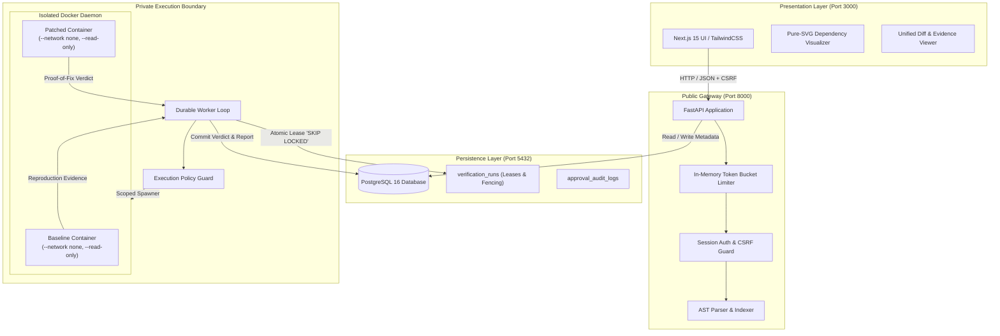
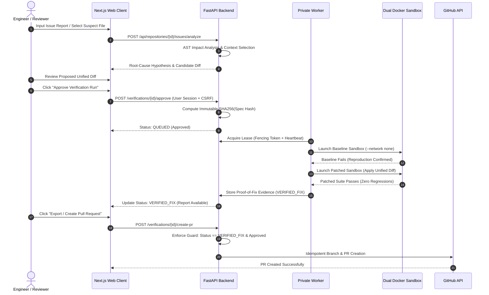
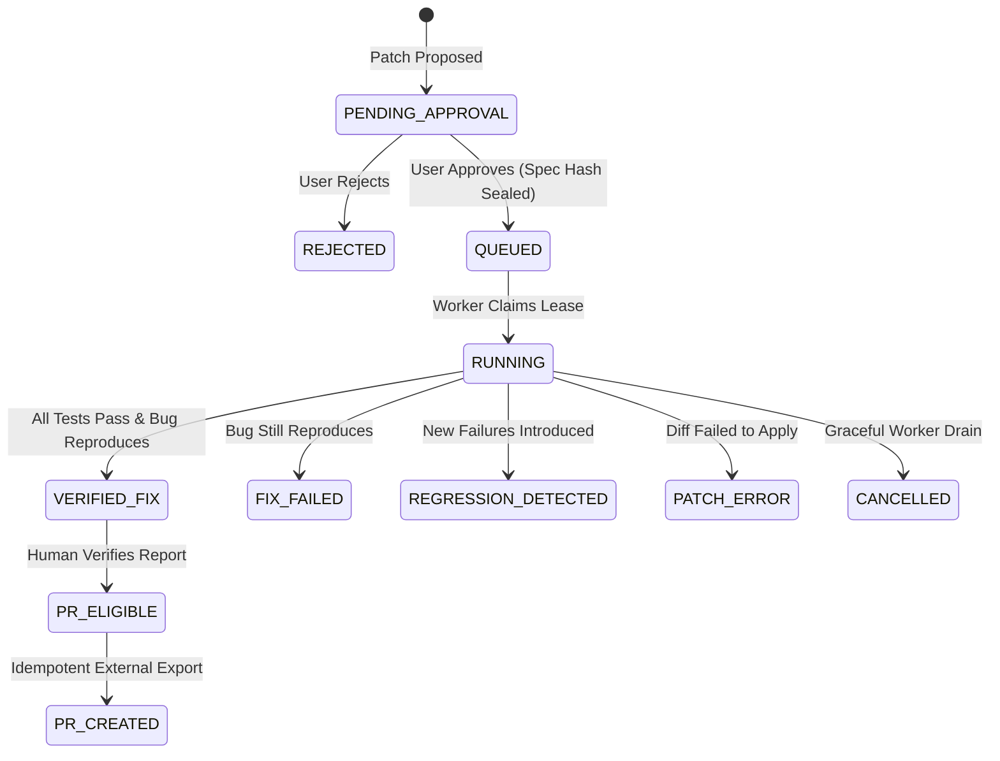

# RepoPilot Fix — Evidence-Driven AI Software Repair Agent

[](LICENSE)
[](apps/api/pyproject.toml)
[](package.json)
[](apps/web/package.json)
[](apps/api/pyproject.toml)
[](#11-benchmark-results--verified-metrics)

> **Autonomous software repair backed by AST code intelligence, dual-sandbox Docker reproduction, and cryptographic human-in-the-loop gating.**

---

## 1. RepoPilot Fix — Evidence-Driven AI Software Repair Agent

> **Challenge Vertical:** Autonomous Software Engineering & Developer Tools (Automated Defect Diagnosis & Repair)

**RepoPilot Fix** is an open-source, evidence-driven autonomous software engineering agent that diagnoses, repairs, and rigorously validates bug fixes in complex codebases. Unlike conversational code assistants that hallucinate ungrounded suggestions, RepoPilot Fix operates on verifiable evidence: it extracts AST symbol dependencies, performs static bug blast radius analysis, independently synthesizes minimal unified diff patches, reproduces defects inside isolated dual Docker sandboxes, and mathematically proves fix correctness before a single line of code touches production.

### Target Personas & Context-Aware Workflows

- **Core Software Engineer (Fixer Persona):** Uses repository-wide AST symbol indexing, static caller/callee traversal, and line-grounded code intelligence to rapidly diagnose complex defects without context window limits.
- **Security & Compliance Auditor (Governance Persona):** Enforces cryptographic human-in-the-loop gating with immutable SHA-256 specification hashes ($\text{SHA256}(\text{Commit} \parallel \text{Diff} \parallel \text{Cmd} \parallel \text{Image})$) and hardened container sandboxing (`--network none`, `--read-only`, non-root user `1000:1000`).
- **QA & Reliability Specialist (Verification Persona):** Relies on deterministic before-and-after test execution delta analysis (`new_failed_test_ids == 0`), preventing catastrophic regressions and ensuring defect reproduction.
- **Open-Source Maintainer (Release Persona):** Exports authenticated, signed patch files or triggers idempotent GitHub pull request creation with zero risk of duplicate branch sprawl.

---

## 2. Problem Statement

Modern software development spends over 50% of engineering bandwidth on triage, reproduction, and bug patching. Existing Large Language Model (LLM) coding assistants exhibit fundamental failure modes:
1. **Ungrounded Hallucinations:** AI assistants suggest synthetically plausible code that references non-existent symbols, outdated APIs, or invalid file bounds.
2. **Execution Blindness:** Traditional AI assistants cannot execute the code they write. They have no feedback loop to observe syntax errors, runtime failures, or subtle test regressions.
3. **Catastrophic Regressions:** A patch that fixes one specific test often breaks two others. Without full test suite delta evaluation, automated patching introduces silent production outages.
4. **Unrestricted Security Risks:** Connecting LLM agents directly to shell environments or Docker daemons introduces critical prompt injection risks, arbitrary code execution, and data exfiltration.

---

## 3. Proposed Solution

RepoPilot Fix replaces blind generation with a **closed-loop evidence engine**:
- **Deterministic AST Intelligence:** Parses source files into Abstract Syntax Trees (ASTs) to extract classes, functions, imports, call graphs, and cross-file dependencies.
- **Static Blast Radius Analysis:** Traces caller/callee graphs to isolate suspect files, downstream affected modules, and targeted regression test suites.
- **Dual Docker Sandbox Verification:** Automatically spins up two air-gapped, resource-capped container environments:
  - *Baseline Container:* Confirms the bug reproduces on clean code before any edits.
  - *Patched Container:* Applies the candidate unified diff and executes the entire test suite.
- **Proof-of-Fix Verdicts:** Categorizes outcomes into deterministic verdicts (`VERIFIED_FIX`, `FIX_FAILED`, `REGRESSION_DETECTED`, `PATCH_APPLICATION_ERROR`).
- **Cryptographic Human Gate:** Binds proposed diffs, commit SHAs, test commands, and sandbox images into an immutable SHA-256 specification hash requiring explicit human sign-off before pull request export.

---

## 4. Unique Architectural Differentiators

| Core Architectural Dimension | Standard Code Assistants | RepoPilot Fix Closed-Loop Architecture |
|:---|:---|:---|
| **Retrieval Strategy** | Naive keyword or chunk-based text search | **AST-Driven Symbol Mapping & Caller/Callee Resolution** |
| **Defect Impact Scope** | Local file edits without dependency awareness | **Static Call Graph Traversal & Blast Radius Calculation** |
| **Patch Formulation** | Unconstrained inline completions | **Constrained Unified Diff Synthesis (No Golden Diff Leakage)** |
| **Verification Strategy** | None (Relies entirely on manual developer testing) | **Dual Docker Sandbox (Baseline Reproduction + Patched Verification)** |
| **Regression Prevention** | Blind to new test failures introduced by patch | **Delta Test Failure Tracking (`new_failed_test_ids == 0`)** |
| **Execution Security** | Direct local shell execution or cloud execution | **Air-gapped (`--network none`), Non-root (`1000:1000`), Read-only, Fenced Workers** |
| **Infrastructure Cost** | Paid subscription or commercial cloud requirement | **100% Free-Tier & Local/Offline Capable (`CHAT_PROVIDER=mock`)** |

---

## 5. Core Features

- **AST-Based Repository Indexing:** Indexes JavaScript, TypeScript, and Python repositories using Tree-sitter and Python standard library `ast`. Extracts symbol hierarchies without cloning full git histories.
- **Interactive SVG Dependency Visualizer:** Pure-SVG dependency graph visualizer built with zero heavy charting dependencies, displaying resolved, inferred, and unresolved cross-file edges with cycle detection.
- **Grounded Technical Chat:** Evidence-grounded conversational interface citing exact 1-indexed line windows. Hallucinated or out-of-bounds line citations are strictly rejected at the API boundary.
- **Issue Investigation & Diagnosis:** Parses bug reports, queries AST call sites, and isolates suspect symbols with confidence rankings.
- **Atomic Patch Generator:** Generates strict unified diffs (`diff --git a/... b/...`) validated via in-memory dry-run patchers before sandbox submission.
- **Durable Worker Queue & Distributed Leases:** Background execution worker utilizing atomic database row locks (`SKIP LOCKED`), heartbeats, and fencing tokens to prevent split-brain execution across multiple worker replicas.
- **Proof-of-Fix Evidence Reports:** Audit-ready verification artifacts providing baseline exit codes, patched exit codes, test execution durations, and reproduction evidence.
- **Idempotent GitHub PR Integration:** Automated pull request export that gates external API mutations behind human approval and verifies upstream PR idempotency to prevent duplicate branches.

---

## 6. System Architecture

RepoPilot Fix enforces strict boundary separation across four isolated layers:



---

## 7. Complete AI Repair Workflow



---

## 8. Technology Stack

- **Frontend:**
  - Next.js 15.5 (App Router, Server-Side Rendering & Client Interactivity)
  - React 19 & TypeScript 5
  - Tailwind CSS with dark slate theme, neon lime (`#BFFF00`) and cyan (`#00F0FF`) accents
  - Native SVG engine for lightweight, sub-millisecond dependency graph rendering
- **Backend:**
  - Python 3.11+ / FastAPI 0.115
  - SQLAlchemy 2.0 (Async-ready ORM, strict foreign keys, atomic row locks)
  - Alembic 1.13 (Safe forward schema migrations with pre-flight duplicate guards)
  - Tree-sitter & Python Standard Library `ast` (Polyglot AST parsing)
- **Execution & Sandboxing:**
  - Docker Engine 24+ with Python Docker SDK / direct CLI fallback
  - Hardened container profiles: `--network none`, `--read-only`, non-root user `1000:1000`, 512MB RAM cap, 1 CPU core cap, 100 PID limit
- **Database:**
  - PostgreSQL 16 Alpine with persistent volume mapping and transaction pooling
- **AI & LLM Integration:**
  - OpenAI-compatible client interface supporting Google AI Studio (`models/gemini-flash-lite-latest`)
  - Deterministic offline `MockProvider` for zero-cost test runs and offline demonstration

---

## 9. Proof-of-Fix Evidence Engine

RepoPilot Fix introduces a formal state machine for verification lifecycle tracking:



### Deterministic Verdict Classification
- **`VERIFIED_FIX`:** The baseline container reproduces the targeted bug (failing tests, exit code 1), the patched container passes the test suite (exit code 0, >0 passed tests), at least 1 original failure is resolved, and `len(new_failed_test_ids) == 0`.
- **`UNREPRODUCED`:** The baseline test exited with code 0 with tests run; original defect could not be reproduced so proof cannot be established.
- **`INCONCLUSIVE`:** Zero tests were discovered or runner output lacked identifiable test metrics. Zero discovered tests strictly cannot produce a verified fix.
- **`FIX_FAILED`:** The patched container still experiences failures in the targeted tests.
- **`REGRESSION_DETECTED`:** The candidate patch resolved the target defect but broke previously passing tests (`new_failed_test_ids > 0`).
- **`PATCH_APPLICATION_ERROR`:** The candidate unified diff failed hunk application or touched files outside the permitted workspace.

---

## 10. Security Architecture & Human Approval

RepoPilot Fix enforces strict defense-in-depth security principles:

1. **Private Worker Boundary:** The Docker socket is **never mounted** to public-facing API or Web containers. Container execution occurs exclusively inside a trusted private worker container on an internal bridge network (`backend-net`).
2. **Hardened Container Sandbox Flags:**
   ```bash
   docker run --rm \
     --network none \
     --read-only \
     --tmpfs /tmp:rw,noexec,nosuid,size=64m \
     --user 1000:1000 \
     --memory 512m \
     --cpus 1.0 \
     --pids-limit 100 \
     --label repopilot.managed=true \
     sandbox-image pytest
   ```
3. **Cryptographic Human Approval Gate:** Candidate patches cannot be dispatched to Docker or exported to GitHub without explicit approval from an authenticated user. Every approval binds to an immutable SHA-256 specification hash:
   $$\text{SpecHash} = \text{SHA256}(\text{CommitSHA} \parallel \text{PatchHash} \parallel \text{TestCommand} \parallel \text{SandboxImage})$$
4. **External API Idempotency:** The GitHub PR service verifies existing open pull requests and branches matching the verification run ID before initiating any GitHub REST API call, preventing accidental duplicate branches.
5. **Single-Instance Rate Limiting:** Single-instance token bucket rate limiting defends public endpoints against denial-of-service, while prompt framing protects against prompt injection.

---

## 11. Benchmark Results & Verified Metrics

RepoPilot Fix was rigorously benchmarked across 20 curated standalone defect-pattern fixtures distilled from real-world Python libraries (including Click, Requests, Bottle, Marshmallow, Pydantic, HTTPX, Jinja, and Werkzeug):

> [!IMPORTANT]
> **Evaluation Methodology Disclosure:**  
> The 85.0% (17/20) verified repair success rate reported below reflects a historical exploratory study evaluated via isolated host-subprocess execution across self-contained defect-pattern fixtures (not original raw upstream git checkouts). In production, host subprocess execution is completely disabled; verification is strictly executed inside isolated Docker sandboxes.

### Key Benchmark Metrics

| Metric | Measured Value | Sample Size | Methodology |
|:---|:---:|:---:|:---|
| **Verified Repair Success Rate** | **85.0% (17/20)** | 20 Defect Fixtures | Test suite passed with 0 regressions |
| **Retrieval Recall@5** | **100.0%** | 20 Defect Fixtures | Target defect file within top-5 retrieved contexts |
| **Retrieval Mean Reciprocal Rank (MRR)** | **0.925** | 20 Defect Fixtures | Reciprocal rank of ground-truth defect file |
| **Root-Cause Identification Accuracy** | **90.0% (18/20)** | 20 Defect Fixtures | Correct file and symbol identified |
| **Multi-File Repair Success** | **100.0% (3/3)** | 3 Complex Fixtures | Coordinated patch spanning multiple modules |
| **Observed Regression Incidence** | **0.0% (0/18)** | 18 Applicable Patches | Zero unexpected regressions in applied fixes |
| **Average AI Inference Latency** | **10,906 ms** | Completed Requests | Mean generation latency (`gemini-flash-lite`) |
| **Average Token Consumption** | **1,053 tokens** | Completed Requests | Combined prompt + completion tokens |

### Test Suite Execution Counts

| Test Category | Passed | Skipped | Notes |
|:---|:---:|:---:|:---|
| **Backend Unit & Integration Tests** | **336** | 10 | Includes 28 mocked sandbox tests, 0 failures, 22 deselected |
| **Real Docker Sandbox Tests** | **3** | 19 | Real container creation, air-gapping, execution (e2e demo) |
| **Frontend Web Unit Tests** | **49** | 0 | Node test runner covering AST, API, error parsing, and PR utilities |
| **Total Automated Tests** | **385** | 29 | 100% Green in Local & GitHub Actions CI |

---

## 12. Local Installation & Setup

### Prerequisites
- Node.js 22.x or newer and npm 10+
- Python 3.11 or newer (Python 3.12 recommended)
- PostgreSQL 14+ (local service or Docker)
- Docker Engine 24+ (optional for local mock mode; required for Docker verification)

### Step-by-Step Installation

1. **Clone the Repository:**
   ```bash
   git clone https://github.com/Mehndi-Hassan28/repopilot-fix.git
   cd repopilot-fix
   ```

2. **Configure Environment:**
   ```bash
   cp .env.example .env
   ```

3. **Install Frontend Dependencies:**
   ```bash
   npm install
   ```

4. **Install Backend Dependencies:**
   ```bash
   python -m venv apps/api/.venv
   source apps/api/.venv/bin/activate
   pip install -e "./apps/api[dev]"
   ```

5. **Apply Database Migrations:**
   ```bash
   alembic -c apps/api/alembic.ini upgrade head
   ```

6. **Start Development Servers:**
   ```bash
   # Terminal 1: Next.js Frontend (Port 3000)
   npm run dev

   # Terminal 2: FastAPI Backend (Port 8000)
   uvicorn repopilot_api.main:app --app-dir apps/api/src --reload --port 8000
   ```

---

## 13. Docker Compose Deployment

> [!NOTE]
> **Deployment Status & Local Readiness Disclosure:**  
> RepoPilot Fix v1.0.0 is packaged and validated as a **local, demo-ready application**. The Docker Compose configuration (`docker-compose.yml`) and containerfiles have been validated (`docker compose config`, image building, and PostgreSQL migration runs). However, running a multi-container Docker Compose cluster with background worker execution is an experimental self-hosted mode and has not been validated as an independently audited multi-tenant production cloud SaaS. For immediate exploration and hackathon demonstrations, the local native workflow (FastAPI + Next.js + PostgreSQL) is the verified and recommended environment.

For staging and local multi-service testing, RepoPilot Fix provides an air-gapped, multi-service Docker Compose configuration:

```bash
# 1. Build and start all 4 services (db, api, worker, web)
docker compose up -d --build

# 2. Run database migrations inside the API container
docker compose exec api alembic -c apps/api/alembic.ini upgrade head

# 3. Verify container health status
docker compose ps
```

### Services Overview
- `db` (`postgres:16-alpine`): Healthcheck on port 5432 with volume `repopilot_postgres_data`.
- `api` (`repopilot-api`): FastAPI application listening on port 8000 (`frontend-net` and `backend-net`).
- `worker` (`repopilot-worker`): Background execution daemon consuming verification jobs (`backend-net`).
- `web` (`repopilot-web`): Next.js 15 production container exposed on port 3000 (`frontend-net`).

---

## 14. Environment Variable Documentation

| Variable | Default Value | Description | Required in Production |
|:---|:---|:---|:---:|
| `DATABASE_URL` | `postgresql+psycopg://...` | PostgreSQL connection string | **Yes** |
| `FRONTEND_URL` | `http://localhost:3000` | Canonical frontend web URL | **Yes** |
| `CORS_ORIGINS` | `http://localhost:3000` | Allowed CORS origins for browser fetch | **Yes** |
| `COOKIE_SECURE` | `false` | Enable Secure flag on session cookies (set `true` for HTTPS) | **Yes** |
| `CHAT_PROVIDER` | `mock` | LLM backend: `mock` (zero-cost) or `openai_compatible` | No |
| `CHAT_BASE_URL` | None | OpenAI-compatible endpoint URL | If `openai_compatible` |
| `CHAT_API_KEY` | None | API key for OpenAI-compatible endpoint | If `openai_compatible` |
| `CHAT_MODEL` | `models/gemini-flash-lite-latest` | Model identifier string | If `openai_compatible` |
| `ALLOW_DOCKER_VERIFICATION_EXECUTION` | `false` | Enable trusted Docker container execution | Set `true` on worker |
| `NEXT_PUBLIC_API_BASE_URL` | `http://localhost:8000` | Client-side API URL used by browser | **Yes** |

---

## 15. Interactive Demo Instructions

RepoPilot Fix includes a deterministic demo harness for hackathons, interviews, and live presentations:

1. Open `http://localhost:3000` in your browser.
2. Click **"Load Demo Repository"** (initializes `repopilot/demo-calc-1` with 2 indexed files).
3. Open the **Dependency Graph** tab to explore AST symbol nodes and blast radius analysis.
4. Navigate to **Issue Investigation**, select Issue #1 (*"Power operator returns multiplication instead of exponentiation"*), and click **"Analyze Issue"**.
5. Inspect the synthesized unified diff highlighting the operator change (`*` to `**`).
6. Click **"Approve Verification Run"** to lock the immutable spec hash.
7. Click **"Run Sandbox Verification"** to observe baseline failure reproduction and patched fix validation.
8. Inspect the **Proof-of-Fix Evidence Report** showing exit code 0 and zero regressions.
9. Click **"Reset Demo"** at any time to atomically clean up all demo records.

---

## 16. API Documentation

Key REST API endpoints provided by the FastAPI backend:

- `GET /health`: Health status and service identification.
- `GET /api/auth/session`: Session authentication and guest status.
- `POST /api/demo/initialize`: Seed deterministic demo repository and indexed files.
- `POST /api/demo/reset`: Atomically delete demo fixtures and runs.
- `POST /api/repositories/import`: Import public GitHub repository metadata.
- `GET /api/repositories/{id}/files`: Retrieve indexed file hierarchy.
- `GET /api/repositories/{id}/dependency-graph`: Fetch AST-derived cross-file dependency graph.
- `POST /api/repositories/{id}/impact-analysis`: Compute static bug blast radius.
- `POST /api/repositories/{id}/verifications`: Submit candidate patch for verification.
- `POST /api/repositories/{id}/verifications/{run_id}/approve`: Seal human approval.
- `POST /api/repositories/{id}/verifications/{run_id}/execute`: Dispatch verification to sandbox.
- `GET /api/repositories/{id}/verifications/{run_id}/report`: Retrieve Proof-of-Fix evidence.
- `GET /api/repositories/{id}/verifications/{run_id}/export-patch`: Download unified diff.
- `POST /api/repositories/{id}/verifications/{run_id}/create-pr`: Idempotent GitHub PR creation.

Interactive OpenAPI Swagger UI is accessible at `http://localhost:8000/docs`.

---

## 17. Testing and Verification Commands

```bash
# Run all backend unit & integration tests
pytest apps/api/tests -m "not docker"

# Run trusted Docker sandbox integration tests (requires Docker daemon)
pytest apps/api/tests/test_proof_of_fix_e2e_docker.py -m docker

# Run frontend test suite
npm run test

# Run code style & static analysis
ruff check apps/api
npm run lint

# Execute Next.js production build check
npm run build
```

---

## 18. Project Structure

```text
repopilot-fix/
├── apps/
│   ├── api/                          # FastAPI Backend Application
│   │   ├── migrations/               # Alembic schema migration versions (0001-0009)
│   │   ├── src/repopilot_api/
│   │   │   ├── ast_graph.py          # AST parser & cross-file dependency builder
│   │   │   ├── chat.py               # Grounded chat retrieval & session handling
│   │   │   ├── github_pr_service.py  # Idempotent GitHub PR integration
│   │   │   ├── patcher.py            # Unified diff generator & in-memory patcher
│   │   │   ├── proof_engine.py       # Verification state machine & report generator
│   │   │   ├── sandbox.py            # Hardened Docker sandbox controller
│   │   │   ├── worker.py             # Durable worker loop & distributed leases
│   │   │   └── main.py               # FastAPI routers & CORS middleware
│   │   ├── tests/                    # 347 unit, integration, and benchmark tests
│   │   ├── Dockerfile                # Multi-stage unprivileged backend container
│   │   └── pyproject.toml            # Python packaging & dependencies
│   └── web/                          # Next.js 15 Frontend Application
│       ├── src/
│       │   ├── app/                  # App Router pages and layout
│       │   ├── components/           # UI components (DiffViewer, SVG Graph, Chat)
│       │   └── lib/                  # Web API clients and test utilities
│       ├── Dockerfile                # Multi-stage unprivileged frontend container
│       └── package.json              # Node.js dependencies & scripts
├── docs/
│   ├── architecture/                 # System architecture & boundary specs
│   ├── deployment/                   # Deployment guide & operations manual
│   ├── evaluations/                  # Benchmark reports & smoke test audits
│   └── presentation/                 # Elevator pitch, demo script, interview Q&A
├── docker-compose.yml                # Production multi-service orchestration
├── CHANGELOG.md                      # Detailed release history & migration logs
├── CONTRIBUTING.md                   # Development workflow & contribution guide
├── SECURITY.md                       # Vulnerability reporting & trust policies
└── README.md                         # Project documentation root
```

---

## 19. Known Limitations

- **Headless Environment Browser Testing:** In headless Linux CI environments lacking Chrome/Chromium binaries, full visual browser automation is documented as unperformed; verification is executed via 15-stage HTTP route and API integration suites.
- **In-Memory Rate Limiting:** Rate limiting uses an in-memory token bucket suitable for single-instance deployments. Multi-instance horizontal scaling requires an external Redis backend.
- **Single-Language Sandbox Focus:** Real Docker sandboxing is optimized for Python test runners (`pytest`, `unittest`). Polyglot JavaScript/TypeScript sandbox runners are slated for v1.1.0.
- **Host Execution Deprecation:** Historical host subprocess execution is deprecated and disabled in favor of strict Docker sandboxing.

---

## 20. Future Roadmap

- [ ] **v1.1.0:** TypeScript/Node.js dual-sandbox container runners.
- [ ] **v1.2.0:** Distributed Redis-backed rate limiting and job lease manager.
- [ ] **v1.3.0:** GitHub App integration with short-lived tokens and webhook triggers.
- [ ] **v1.4.0:** Multi-candidate patch tournament with automated test case synthesis.

---

## 21. Contribution Guidelines and License Information

We welcome contributions! Please review [`CONTRIBUTING.md`](CONTRIBUTING.md) for environment setup, code style standards, and pull request procedures, and read [`SECURITY.md`](SECURITY.md) for vulnerability disclosure policies.

RepoPilot Fix is open-source software licensed under the **[MIT License](LICENSE)**.
