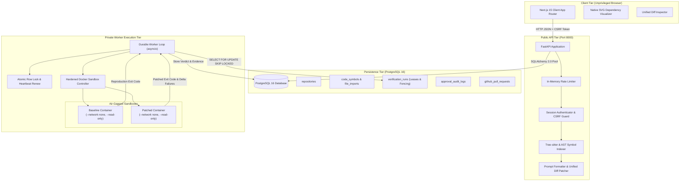
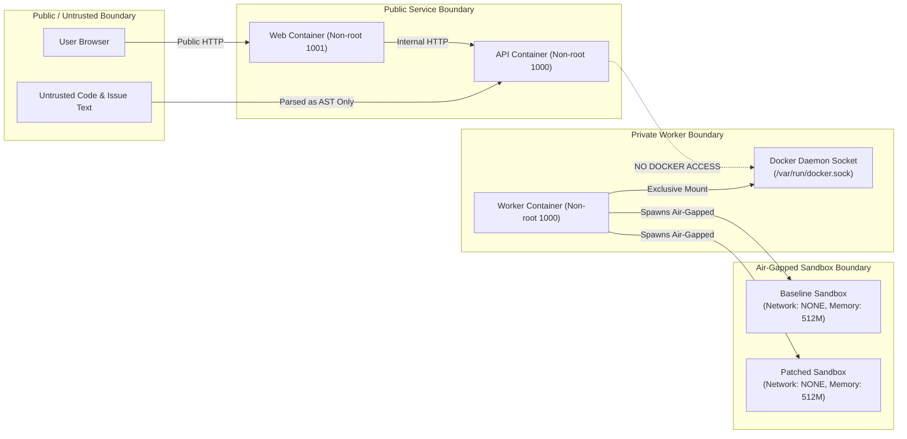
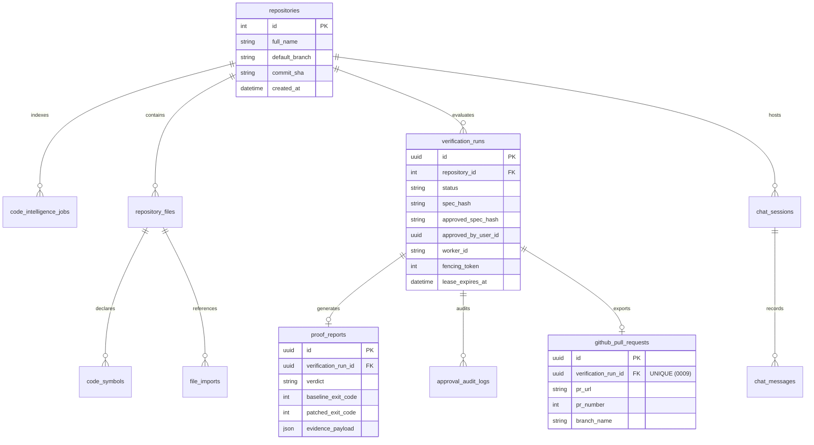
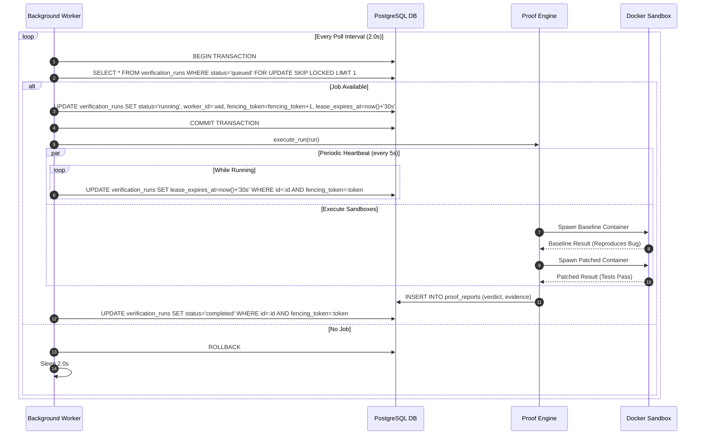
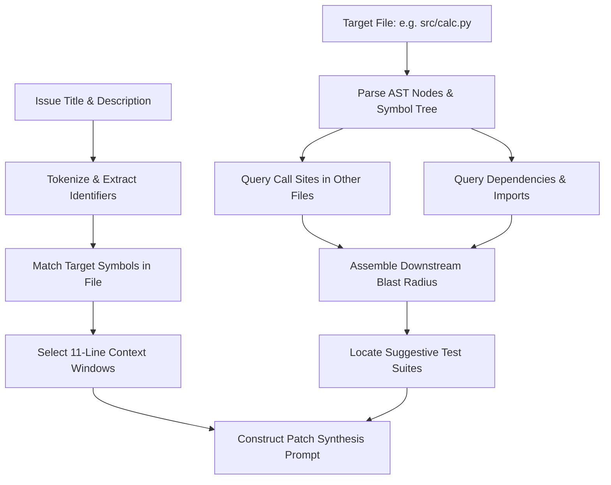

# RepoPilot Fix — System Architecture & Technical Specifications

**Version:** 1.0.0 (Release)  
**Classification:** Technical System Architecture Documentation  

---

## 1. High-Level Architectural Model

RepoPilot Fix is architectured around the principle of **untrusted inputs, isolated execution, and cryptographically verified outputs**. The application comprises four distinct operational tiers:



---

## 2. Trust Boundaries & Security Enclaves

RepoPilot Fix strictly segregates privileges to prevent untrusted code execution or prompt injection from escalating privileges:



### Trust Boundary Rules
1. **Zero Public Socket Mounts:** The Docker socket `/var/run/docker.sock` is **never mounted** to the public API container or the Next.js web container.
2. **Air-Gapped Network:** Sandboxes run with `--network none`. They cannot connect to internal databases, cloud APIs, or the host.
3. **Non-Root Sandboxes:** Container processes execute as `1000:1000`. Root operations inside sandboxes are blocked.
4. **Temporary Filesystem Caps:** Temporary directories use `--tmpfs /tmp:rw,noexec,nosuid,size=64m`. Binary execution from `/tmp` is prohibited.
5. **Scoped Resource Cleanup:** Every container is labeled with `repopilot.managed=true`. A strict cleanup supervisor terminates orphaned containers on boot and upon run completion.

---

## 3. Database Architecture & Schema Relationships



### Schema Migration Integrity
- Schema migrations are managed through Alembic and are **never executed automatically on application startup**.
- **Migration 0009 (`0009_github_pull_requests_unique_run.py`):** Adds a unique constraint on `github_pull_requests.verification_run_id`. Before altering the schema, it runs a pre-flight duplicate query:
  ```sql
  SELECT verification_run_id, COUNT(*) 
  FROM github_pull_requests 
  GROUP BY verification_run_id 
  HAVING COUNT(*) > 1;
  ```
  If duplicates are found, it raises a descriptive `RuntimeError` rather than silently dropping records.

---

## 4. Distributed Concurrency & Worker Lease State Machine



---

## 5. Blast Radius & AST Dependency Intelligence

When an issue or suspect file is analyzed, the AST Engine executes the following static pipeline:



This ensures that the LLM is supplied with exact, bounded 1-indexed line windows and accurate caller/callee context, eliminating out-of-bounds citations and context blindness.
